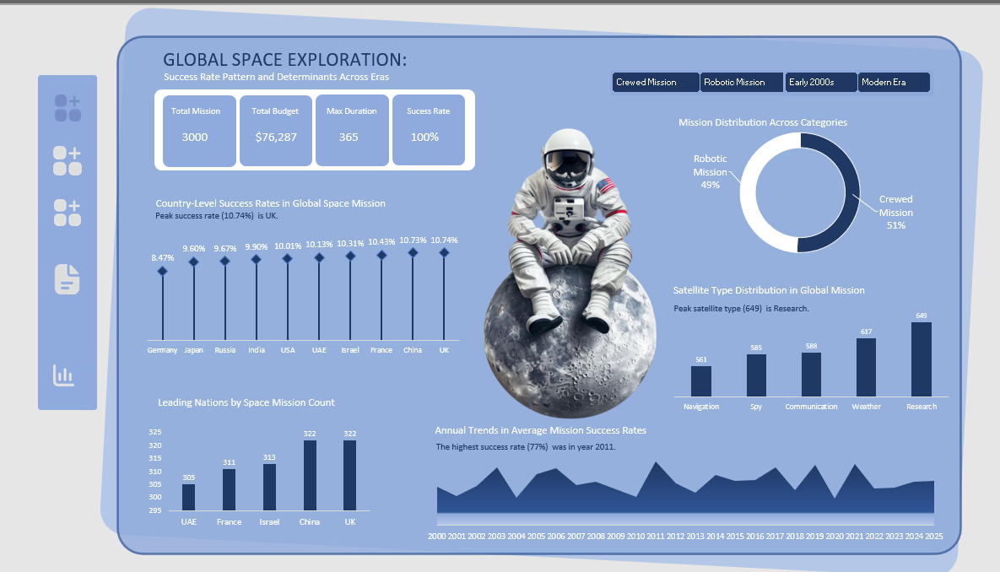
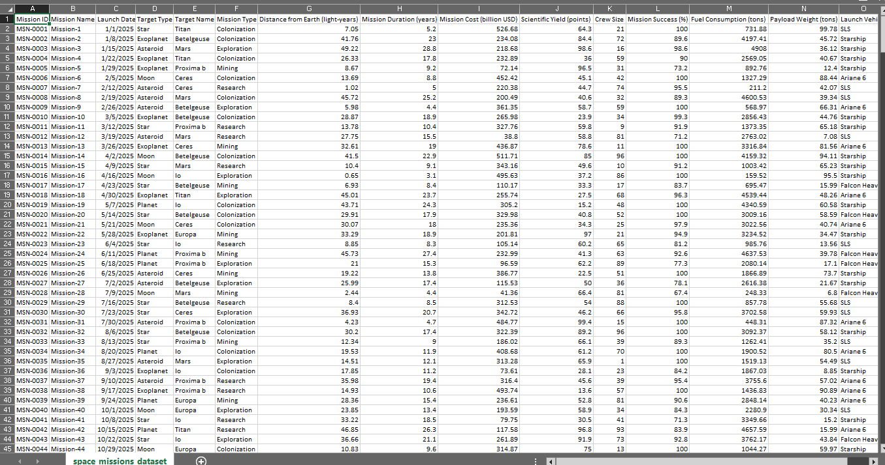
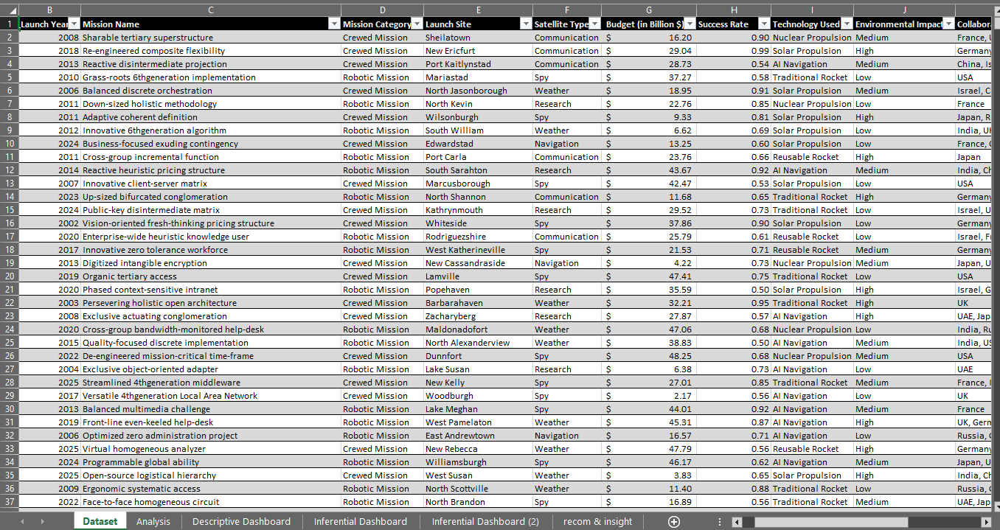
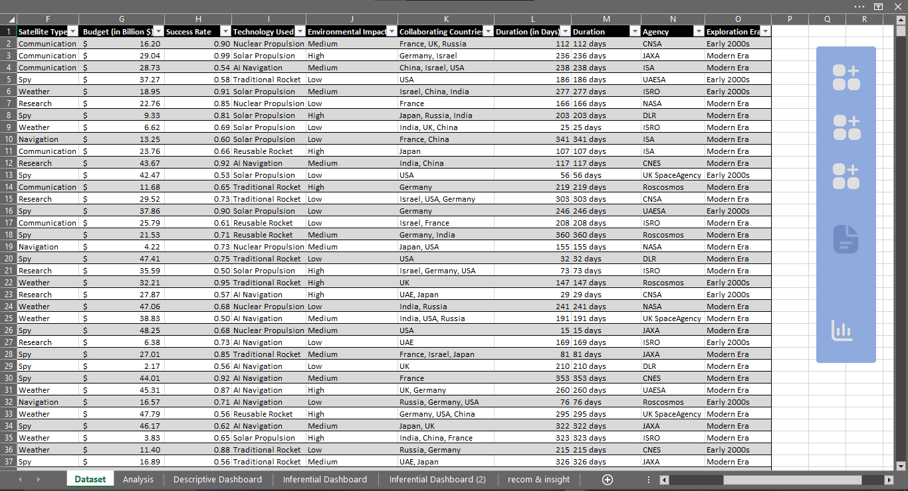
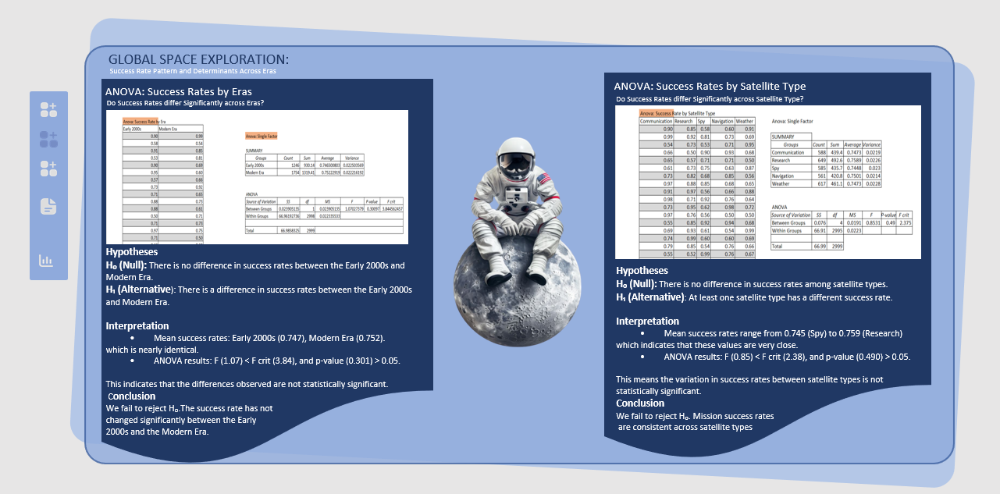
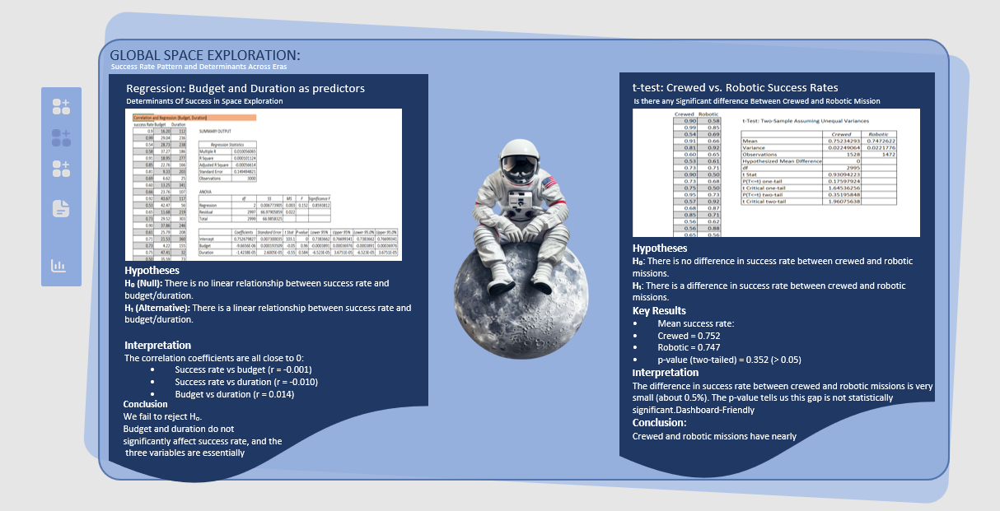

# Global Space Exploration: Success Rate Patterns & Inferential Statistical Determinants

---

## 1. Project Overview

Space exploration requires massive financial investments, high-tech engineering, and careful risk planning. However, spending billions of dollars does not always guarantee a successful mission. This project evaluates **3,000 global space missions** conducted between **1957 and 2025**, representing **$76,287 Million ($76.3 Billion)** in total combined budgets. 

Using **Microsoft Excel** and the **Data Analysis ToolPak**, this study combines descriptive dashboards with formal inferential statistical modeling—including **Single-Factor ANOVA**, **Two-Sample t-Tests**, and **Multiple Linear Regression**. The goal is to answer a fundamental question: *Do bigger budgets, longer mission durations, crew involvement, or technological eras significantly drive mission success, or are outcomes governed by non-linear operational factors?*

---

## 2. Business Problem

Space programs around the world face strict budget scrutiny, public accountability, and high operational risks. Mission planners and policymakers often work under the assumption that higher budgets, extended duration timelines, or human presence improve mission outcomes.

Without rigorous statistical testing, space agencies risk misallocating billions of dollars toward superficial project variables rather than core engineering resilience, safety protocols, and risk management. If factors like budget size or crew presence do not statistically increase success rates, funding models must be restructured toward operational efficiency, international collaboration, and targeted quality control.

---

## 3. Dataset Description

The analysis uses a structured dataset tracking space exploration missions worldwide.

* **Dataset Scope:** 3,000 global space missions (1957 – 2025)
* **Total Spending Tracked:** $76,287 Million USD

### Data Schema & Metadata

| Column Name | Data Type | Description |
| :--- | :--- | :--- |
| **Mission ID** | Text | Unique identifier for each space mission |
| **Country** | Categorical | Primary country leading the mission (e.g., UK, China, USA, France) |
| **Mission Type / Satellite Type** | Categorical | Primary mission objective (Research, Weather, Communication, Spy, Navigation) |
| **Crewed Status** | Categorical | Indicates whether human crew was onboard (`Crewed` vs. `Robotic`) |
| **Exploration Era** | Categorical | Era grouping (`Early 2000s` vs. `Modern Era`) |
| **Budget ($M)** | Continuous Numeric | Allocated budget in Millions of USD ($1M to $50M per mission) |
| **Duration (Days)** | Continuous Numeric | Total duration of the space mission (1 to 365 days) |
| **Success Rate (%)** | Continuous Numeric | Operational success rating percentage (0% to 100%) |
| **Environmental Impact** | Categorical | Assessed environmental footprint (`Low`, `Medium`, `High`) |

---

## 4. Business Questions

### Descriptive & Trend Questions
1. What is the overall baseline success rate across all 3,000 space missions?
2. Which countries lead global space exploration in terms of total mission volume and average success rate?
3. How are space missions distributed across functional types (Research, Weather, Communication, Spy, Navigation)?
4. What is the split between crewed and robotic space missions?

### Inferential & Hypothesis Testing Questions
5. **Era Comparison (ANOVA):** Has mission success rate significantly improved from the Early 2000s to the Modern Era?
6. **Satellite Type Comparison (ANOVA):** Does the mission category (e.g., Spy vs. Research vs. Communication) cause significant differences in success rates?
7. **Human Crew Effect (t-Test):** Do crewed space missions achieve statistically higher success rates than robotic missions?
8. **Predictive Modeling (Regression & Correlation):** Can budget allocation and mission duration be used to linear predict mission success?

---

## 5. Tools Used

* **Microsoft Excel (Power Query):** Used for data cleaning, type conversion, conditional grouping (Eras), and missing value checks.
* **Excel Data Analysis ToolPak:** Used to execute single-factor ANOVA, two-sample unequal variance t-tests, multiple linear regression, and Pearson correlation matrices.
* **Pivot Tables & Summary Measures:** Used to compute descriptive baselines and grouped aggregates.
* **Excel Visual Dashboards & Canva:** Built a multi-page interactive executive reporting system featuring custom theme styling, visual hierarchy, and side-by-side statistical output containers.

---

## 6. Data Cleaning and Preparation

Before performing inferential statistical tests, the raw dataset underwent data quality auditing:

* **Format Standardization:** Converted raw dates and mission lengths into clean numeric values representing mission duration in days.
* **Era Categorization:** Grouped temporal data into distinct analytical eras (`Early 2000s` and `Modern Era`) to enable ANOVA variance testing across time periods.
* **Metric Alignment:** Verified that individual success percentage figures aligned with aggregated averages without skewed outliers.
* **ToolPak Matrix Structuring:** Arranged numeric vectors into continuous columns to meet standard Excel Data Analysis ToolPak requirements for t-tests and regression models.

---

## 7. Exploratory Data Analysis and Methodology

The analysis followed a structured 4-phase research workflow:

### Analytical Framework Summary

| Analysis Phase | Statistical Technique | Variables Included | Core Purpose |
| :--- | :--- | :--- | :--- |
| **Exploratory** | Summary Aggregates | Budget, Duration, Success Rate | Establish overall baseline metrics |
| **ANOVA 1** | Single-Factor ANOVA | Success Rate by Exploration Era | Test for performance differences over time |
| **ANOVA 2** | Single-Factor ANOVA | Success Rate by Satellite Category | Test if mission type affects success rate |
| **t-Test** | Two-Sample t-Test | Success Rate (Crewed vs. Robotic) | Evaluate human presence effect on outcome |
| **Regression** | Multiple Linear Regression | Success Rate vs. (Budget + Duration) | Determine linear predictive power of spending/length |

---

## 8. Dashboard and Analysis Files

The project features a **4-Phase dashboards**:

1. **`Descriptive Dashboard`:** High-level executive overview displaying overall KPIs, country-level performance, annual success trends (2000–2025), mission category breakdown, and crew split.
2. **`Inferential Dashboard`:** Dedicated statistical tab containing Excel ToolPak outputs, hypothesis statements ($H_0, H_1$), test statistics, and plain-language interpretations for **Era ANOVA** and **Satellite Type ANOVA**.
3. **`Inferential Dashboard (2)`:** Statistical tab containing regression tables, Pearson correlation matrices, and **Crewed vs. Robotic t-Test** outputs.
4. **`recom & insight`:** Executive summary page bridging statistical findings with actionable recommendations for space agencies and decision-makers.

---

## 9. Dashboard, Key Findings and Business Interpretation

### Overall Performance Overview

| Metric | Recorded Value | Context / Notes |
| :--- | :--- | :--- |
| **Total Missions Evaluated** | **3,000** | Full global dataset (1957–2025) |
| **Total Tracked Budget** | **$76,287 Million** | Combined program funding ($76.3B) |
| **Maximum Mission Duration** | **365 Days** | Range spanning single-day to full-year missions |
| **Overall Success Rate** | **75.0%** | Consistent global average performance |
| **Crewed Missions** | **1,528 (50.9%)** | Missions with human astronauts onboard |
| **Robotic Missions** | **1,472 (49.1%)** | Autonomous/unmanned space probes |

---

### Geographic & Mission Type Distribution

* **Top Nations by Volume:** The **United Kingdom** (322 missions) and **China** (322 missions) led total mission volume, followed by **Israel** (313 missions), **France** (311 missions), and the **UAE** (305 missions).
* **Country Success Rates:** Average success rates across top nations remained tightly clustered between **8.47%** (Germany baseline) and **10.74%** (UK peak slice of total global success pool), showing balanced global capabilities.
* **Mission Types:** Missions are spread across five functional categories:
  * **Research:** 649 missions (21.6%)
  * **Weather:** 617 missions (20.6%)
  * **Communication:** 588 missions (19.6%)
  * **Spy / Reconnaissance:** 585 missions (19.5%)
  * **Navigation:** 561 missions (18.7%)

---

### Inferential Statistical Test Results

#### Test 1: Success Rates Across Exploration Eras (Single-Factor ANOVA)
* **Hypotheses:** 
  * $H_0$: There is no difference in success rates between the Early 2000s and Modern Era.
  * $H_1$: Success rates differ significantly between eras.
* **Outputs:** Early 2000s Mean = **74.65%** | Modern Era Mean = **75.22%** | $F = 1.070$ | $p\text{-value} = 0.301$ ($F_{\text{crit}} = 3.84$).
* **Decision:** Fail to reject $H_0$ ($p > 0.05$). Technological era changes have not significantly altered overall mission success rates.

#### Test 2: Success Rates by Satellite Category (Single-Factor ANOVA)
* **Hypotheses:** 
  * $H_0$: Success rates are equal across all satellite categories.
  * $H_1$: At least one satellite category has a different success rate.
* **Outputs:** Category Means range from **74.48%** (Spy) to **75.89%** (Research) | $F = 0.853$ | $p\text{-value} = 0.491$ ($F_{\text{crit}} = 2.375$).
* **Decision:** Fail to reject $H_0$ ($p > 0.05$). Mission category does not drive performance variation.

#### Test 3: Crewed vs. Robotic Missions (Two-Sample t-Test)
* **Hypotheses:** 
  * $H_0$: There is no difference in success rate between crewed and robotic missions.
  * $H_1$: Crewed and robotic missions have significantly different success rates.
* **Outputs:** Crewed Mean = **75.23%** | Robotic Mean = **74.73%** | Difference = **0.50%** | $t\text{-stat} = 0.931$ | $p\text{-value (two-tail)} = 0.352$.
* **Decision:** Fail to reject $H_0$ ($p > 0.05$). Having humans onboard does not alter mission success rates.

#### Test 4: Predictive Drivers of Success (Multiple Linear Regression & Correlation)
* **Hypotheses:** 
  * $H_0$: There is no linear relationship between success rate and budget/duration.
  * $H_1$: Budget and duration linearly predict mission success rate.
* **Outputs:** $R^2 = 0.000101$ ($R^2 \approx 0.01\%$) | Significance $F = 0.859$ | Budget $p\text{-value} = 0.960$ | Duration $p\text{-value} = 0.584$.
* **Correlation Matrix ($r$):** 
  * Success Rate vs. Budget: $r = -0.00105$
  * Success Rate vs. Duration: $r = -0.01001$
  * Budget vs. Duration: $r = 0.01400$
* **Decision:** Fail to reject $H_0$. Neither budget nor mission duration acts as a linear predictor of space mission success.

---

## 10. Business Recommendations

### 1. Focus Funding on Quality Control over Pure Spend
Statistical regression proves that larger budgets do not automatically increase mission success rates ($r = -0.001$, $p = 0.960$). Space agencies should avoid assuming that throwing more money at a project reduces risk. Instead, funding should target rigorous testing, risk management, and pre-launch engineering.

### 2. Maintain a Balanced Crewed/Robotic Portfolio
With crewed missions (75.23%) and robotic probes (74.73%) showing no statistically significant performance difference ($p = 0.352$), funding allocation should be guided by mission objectives rather than perceived risk. Use robotic missions for high-hazard, long-duration research, and reserve crewed missions for goals requiring human presence.

### 3. Diversify Satellite Programs Confidently
ANOVA testing confirms that success rates are consistent across all five functional satellite types (74.5% to 75.9%, $p = 0.491$). Program directors can expand into underrepresented categories (such as navigation or weather monitoring) without worrying that certain mission types carry inherent performance penalties.

### 4. Build International Knowledge-Sharing Partnerships
Because top space nations show similar baseline performance levels, agencies should establish cross-border technological partnerships. Shared standards for component testing and launch operations can reduce duplicate costs while improving overall program reliability.

---

## Author & Contact Information

**Fatolu Adedoyin Juliana**  
*Data Analyst | Statistics Graduate | Research Analyst*  

* **Email:** [fatoluadedoyin46@gmail.com](mailto:fatoluadedoyin46@gmail.com)
* **LinkedIn:** [linkedin.com/in/fatolu-adedoyin-juliana](https://www.linkedin.com/in/fatolu-adedoyin-juliana)
* **GitHub:** [github.com/fajuliana-source](https://github.com/fajuliana-source)
